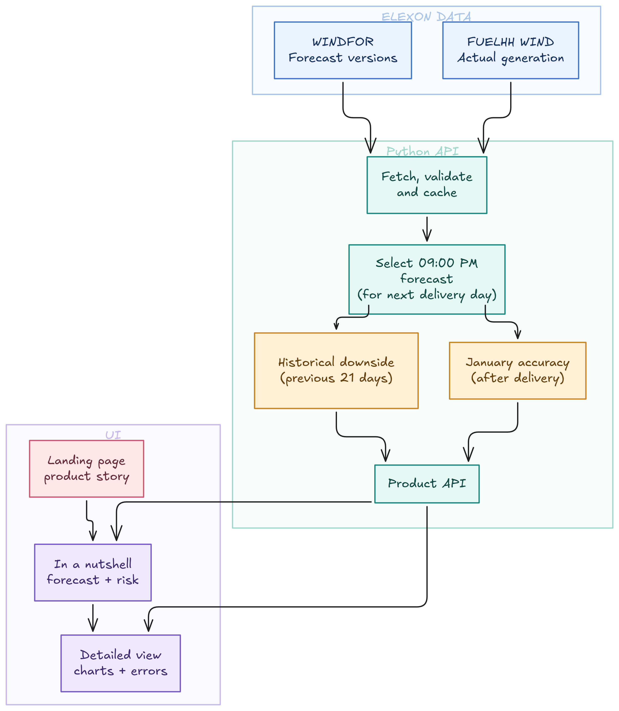

# Windward

Windward helps a Great Britain electricity buying desk judge tomorrow's wind before it commits to day-ahead purchases. The pilot covers buying decisions made between **1–31 January 2026** using only Elexon's wind forecast and actual-generation feeds.

## Implementation approach



The project has two parts:
### Python API:
- FastAPI serves the January overview through the selected decision date 
- The service computes past forecast accuracy, a cautious planning wind level
- caches Elexon data for repeated requests

### React client:
- The landing page explains the buying problem.
- The dashboard offers a quick decision view, hourly charts, and a detailed retrospective review.

Decisions made on the app are documented at: [DECISIONS.md](./DECISIONS.md)
## Project layout

| Path | Purpose |
| --- | --- |
| `client/src/pages/`, `client/src/landing.css` | Landing page, dashboard, and visual styles |
| `api/app/adapters/` | Source interface and Elexon adapter |
| `api/app/services/` | Snapshot preparation, decision calculations, comparison |
| `api/app/routers/`, `api/app/schemas/` | HTTP routes and response models |
| `api/app/settings.py`, `api/.env.example` | Validated server configuration and defaults |
| `api/tests/` | Cutoff, alignment, calculation, and leakage checks |
| `hld.png`, `docker-compose.yml` | Initial HLD and local deployment |

## Local setup

From the repo root, run:

```bash
docker compose up --build
```

Open the [app](http://localhost:8088) or [API docs](http://localhost:8000/docs).

To run without Docker, use two terminals:

```bash
cd api
python3 -m venv .venv
source .venv/bin/activate
pip install -r requirements.txt
uvicorn app.main:app --reload
```

```bash
cd client
npm ci
npm run dev
```

Open the [local app](http://localhost:8088). The API needs internet access to Elexon. Copy `api/.env.example` to `api/.env` only if you need to change the defaults.

## What will I do If get more time
Currently the prediction optimizes for accuracy of wind energy generation, but the user might want to optimize for 'least dependecy on thermal power'. With more time, I could develop different algorithm to optimize for different needs, and provide that as a dropdown UX for the user. 

### Note
`GPT 6 sol` model was used for coding(especially the landing page in the UI).
